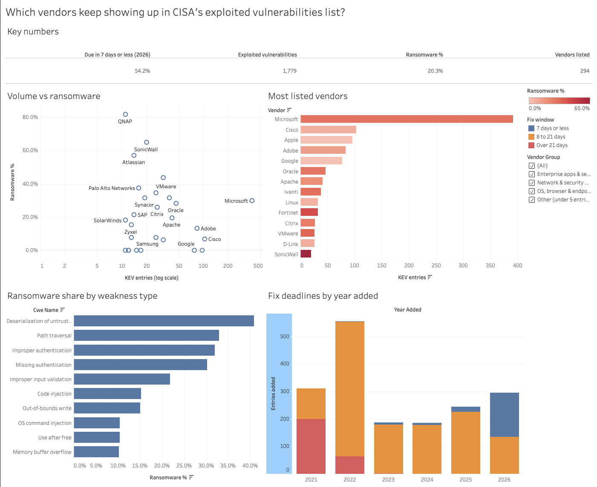

# KEV Vendor Risk Analysis

Looking at CISA's Known Exploited Vulnerabilities (KEV) catalog by vendor, using SQL and Tableau.

Most of what I review in a vendor assessment comes from the vendor (SOC reports, pen tests, questionnaires). The KEV catalog is public and every entry names a vendor and product, so I wanted to see what it says about vendors on its own.

Dashboard: https://public.tableau.com/app/profile/enoch.fatade/viz/KEVVendorRiskAnalysis/WhichvendorskeepshowingupinCISAsexploitedvulnerabilitieslist

## Data

CSV from https://github.com/cisagov/kev-data, pulled Nov 10 2026. 1,779 vulnerabilities across 294 vendors, added between Nov 2021 and Nov 2026.

I used DB Browser for SQLite for the SQL and Tableau Public for the dashboard.

## Findings

- The top 10 vendors are 52.8% of the catalog. Microsoft is 22% by itself (391 entries).
- Having the most entries doesn't mean having the worst ransomware numbers. 20.3% of all entries are flagged for known ransomware use. For vendors with 10+ entries:

| Vendor | Entries | Ransomware use |
|---|---|---|
| QNAP | 11 | 81.8% |
| SonicWall | 20 | 65.0% |
| Atlassian | 14 | 57.1% |
| Fortinet | 32 | 43.8% |
| Palo Alto Networks | 16 | 37.5% |
| Microsoft | 391 | 29.9% |
| Cisco | 103 | 6.8% |
| Apple + Google | 173 | 0% |

- I grouped vendors into three buckets thinking network/security appliance vendors would be clearly worse. They weren't really: 24.6% vs 25.5% for enterprise apps and 17.8% for OS/browser/endpoint. SonicWall and Fortinet are high but Cisco and D-Link are low, so it depends on the vendor more than the group.
- Fix deadlines got shorter in 2026. 2023 to 2025 was nearly all 21 days, with under 8% due within a week. In 2026 it's 54.2% due within 7 days, and 157 of the 295 are due in 3.
- Old CVEs still get added. Of 913 entries added since 2023, 20.9% were 2+ years old and 10.4% were 5+ years old.
- Deserialization (40.8%) and path traversal (32.9%) flaws are ransomware linked a lot more often than memory bugs (12.1%).
- 2026 has 295 additions through Nov 10. All of 2025 was 245 and 2024 was 186.

For vendor reviews, what I take from this is to check the ransomware share and not only the count, and to ask vendors what their patch SLA is for KEV listed vulnerabilities. A 30 day SLA doesn't line up with a 3 day deadline.

## Things to keep in mind

- KEV only has vulnerabilities CISA confirmed as exploited. It doesn't tell you how secure a vendor is overall, and bigger vendors have more products and more users.
- Ransomware use "Unknown" means unknown, not no.
- 287 entries were loaded the day the catalog launched and 2022 has a lot of backlog too, so 2021 and 2022 aren't real yearly counts.
- The vendor groups are mine, done at vendor level for the 53 vendors with 5+ entries.
- 175 entries have no CWE.
- There are no patch dates in the data, so nothing here is about how fast vendors patch.

## Files

- `data/known_exploited_vulnerabilities.csv` raw file from CISA
- `sql/01_clean.sql` cleaning, vendor groups, CWE split
- `sql/02_analysis.sql` queries behind the findings
- `sql/03_tableau_views.sql` views exported for Tableau
- `tableau/kev_clean.csv` one row per vulnerability
- `tableau/kev_cwe.csv` one row per vulnerability per CWE

To rerun it, import the raw CSV into SQLite as `kev_raw` (tick "Column names in first line" on import) and rename the columns to `cve_id, vendor, product, vuln_name, date_added, short_description, required_action, due_date, ransomware_use, forensic_triage, notes, cwes`. Then run the three SQL files in order.
